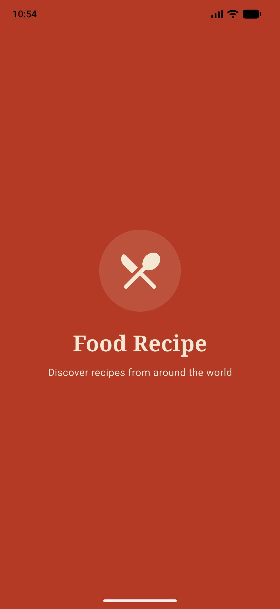
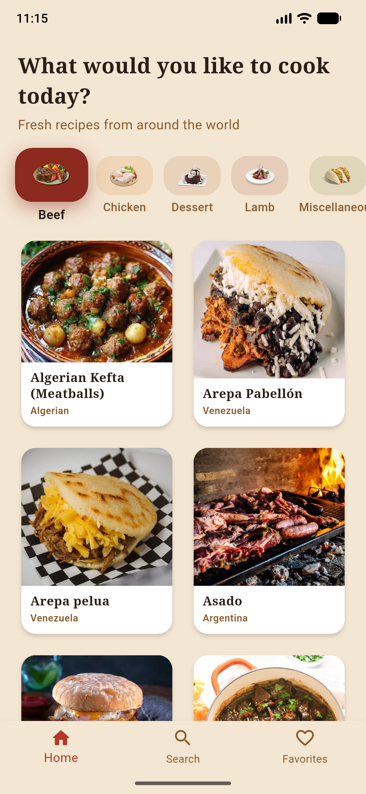
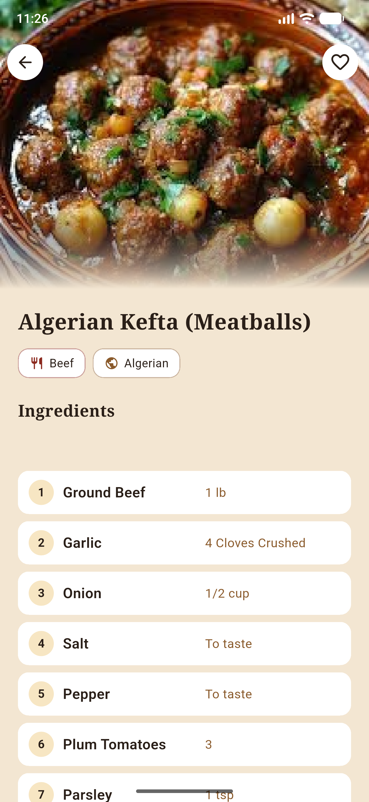
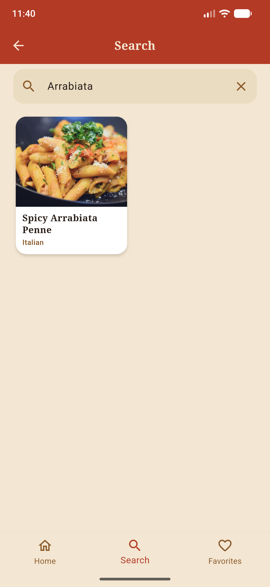
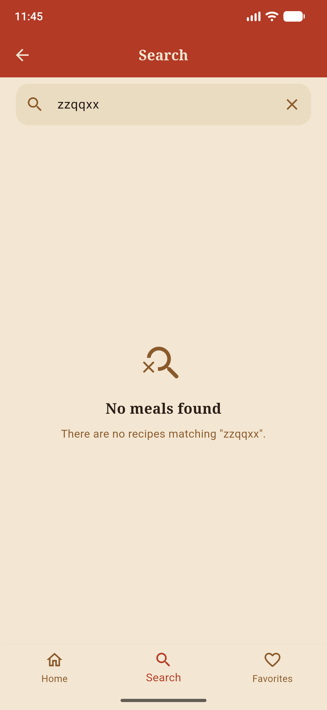
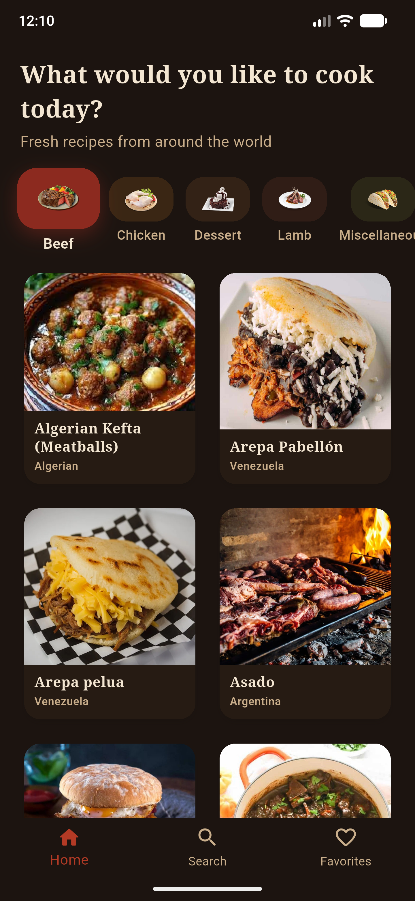
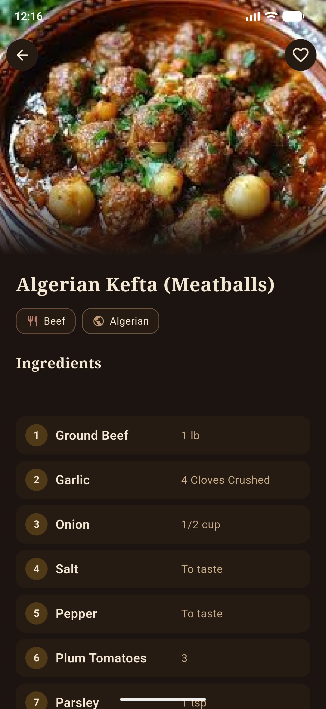
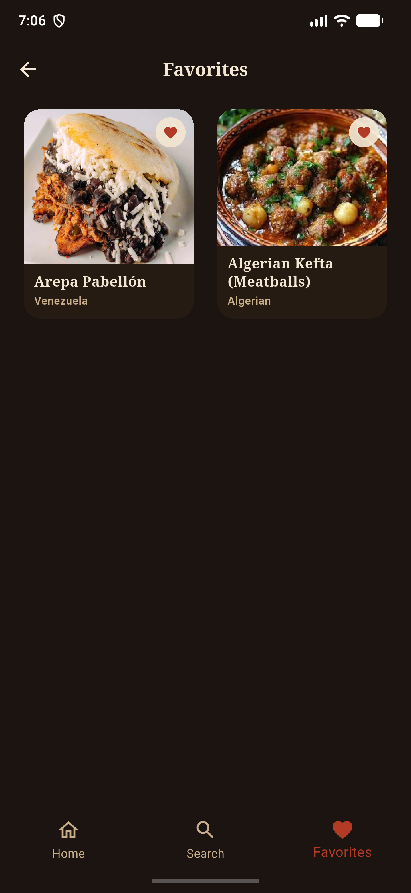
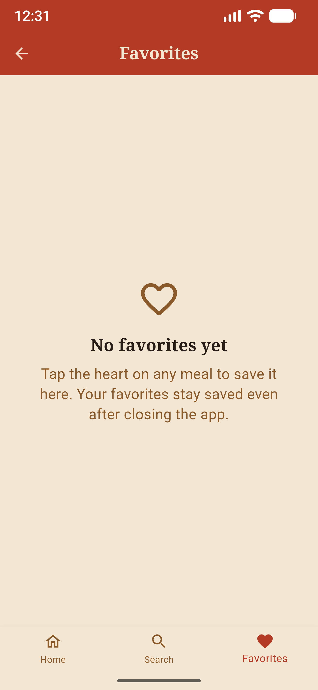

# The Spice Stall — a recipe browser on TheMealDB

Built with Flutter for the DEPI (Digital Egypt Pioneers Initiative) practical
assessment. Browse meal categories from the free, open
[TheMealDB](https://www.themealdb.com/api.php) API, open full recipe details
(ingredients with measures, preparation steps, a YouTube video button), search
meals by English name, and keep a personal favorites list that persists across
app restarts.


## Screens

| Screen | What it does | Screenshot |
|---|---|---|
| **Home** | Horizontal categories strip (`ListView.builder`) with a selected-state pigment + two-column meals grid (`GridView.builder`), with loading and error states | [02-home](docs/second_round/02-home.png) · [03-category-beef](docs/second_round/03-category-beef.png) |
| **Meal Details** | Collapsible hero image header, meal name with origin (`strArea`) and category chips, ingredients with measures, preparation steps, YouTube button (`url_launcher`), favorite heart | [04-meal-details](docs/second_round/04-meal-details.png) |
| **Search** | English meal-name search hitting `search.php?s=` with a 500 ms debounce and a designed empty state ("No meals found") | [05-search-results](docs/second_round/05-search-results.png) · [06-search-empty](docs/second_round/06-search-empty.png) |
| **Favorites** | Saved meals stored locally with `shared_preferences`, persisting after app close/restart, removable per card | [12-favorites-dark](docs/second_round/12-favorites-dark.png) |

A Splash screen opens the app, and a bottom navigation bar (`IndexedStack`)
links Home, Search, and Favorites. Dark mode follows the system setting
(`ThemeMode.system`), and large-font scaling is supported.

## Architecture

Clean architecture with a `doc_doc`-style layout — business logic separated
from UI, state management via **Cubits only** (`flutter_bloc`):

```
lib/
├── core/                       shared infrastructure
│   ├── di/                     manual service locator
│   ├── networking/             dio factory, API service, error handling
│   ├── routing/                route constants + onGenerateRoute
│   ├── theming/                Spice-Stall palettes, typography, category pigments
│   └── widgets/                shared widgets (MealCard, error/empty/loading)
└── features/<feature>/
    ├── data/                   models (hand-written null-safe fromJson) + repositories
    ├── logic/                  Cubits
    └── ui/                     screens + widgets
```

Exactly the five exam-allowed packages:
`dio` · `flutter_bloc` · `shared_preferences` · `cached_network_image` ·
`url_launcher`.

## Bonus features

- **Debounced search** — the network call fires 500 ms after typing stops,
  not on every keystroke (`SearchCubit`).
- **Hero image transition** — the meal photo flies between the grid card and
  the details header in both navigation directions: into the header when a
  meal is opened, and back to the card when navigating back.
- **Per-category pigments** — every category carries its own fixed accent
  color (`CategoryColors`), lifted for dark-mode contrast.

## Run it

```bash
flutter pub get
flutter run                      # with an Android emulator/device attached
flutter build apk --debug        # debug APK
```

Try it: search **Arrabiata** — TheMealDB returns *Spicy Arrabiata Penne*.

## Screenshots

Light:

| | |
|---|---|
|  |  |
|  |  |
|  |  |

Dark:

| | |
|---|---|
|  |  |
|  | |

Large fonts:



---

Developed with AI coding assistance.
